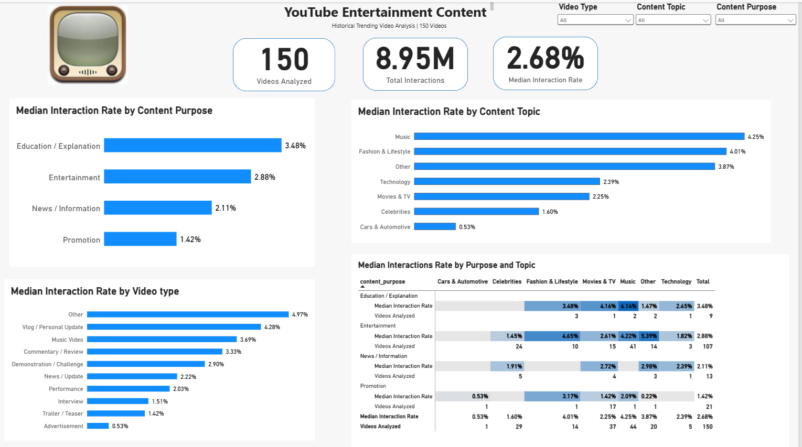

# YouTube Entertainment Content Performance Analysis

### Python | Pandas | Power BI | Data Analytics

## Project Overview

This project analyzes the performance of 150 unique entertainment-related videos sampled from a historical U.S. YouTube trending dataset.

The objective was to investigate how video type, content purpose, and content topic relate to audience interactions, and to translate the findings into actionable recommendations for entertainment content strategy.

The project combines Python-based data preparation and exploratory analysis with an interactive Power BI dashboard.

## Business Questions

1. Which video types generate the highest interaction-to-view rates?
2. How does content purpose relate to audience interaction?
3. Which content topics demonstrate stronger performance?
4. Which combinations of content purpose and topic warrant further investigation?

## Tools and Skills

- **Python and Pandas:** Data cleaning, deduplication, sampling, validation, and exploratory data analysis
- **Excel:** Manual content classification and review
- **Power BI:** Interactive dashboard development, DAX measures, slicers, and matrix visualizations
- **Data Analytics:** KPI development, segmentation, descriptive statistics, and business recommendations

## Methodology

1. Used a historical U.S. YouTube trending dataset as the source.
2. Filtered the data to entertainment-related categories.
3. Selected the latest available trending observation for each video.
4. Created a stratified sample of 150 unique videos.
5. Classified videos across three dimensions: video type, content purpose, and content topic.
6. Validated the dataset, corrected missing video identifiers, and calculated performance metrics using Python.
7. Analyzed median performance across content segments.
8. Developed an interactive Power BI dashboard.

### Key Performance Metric

**Interaction-to-View Rate (%) = (Likes + Comments) / Views × 100**

The median of individual video interaction-to-view rates was used to compare content categories and reduce the influence of extreme observations.

## Dashboard

The Power BI dashboard includes:

- Total videos analyzed
- Total audience interactions
- Median interaction-to-view rate
- Performance comparisons by video type, purpose, and topic
- Purpose × Topic performance matrix
- Interactive filters for exploring content segments

## Key Findings

### 1. Music content demonstrated strong audience interaction

Music videos and music-related content showed relatively high interaction-to-view rates in the sample.

The Music content topic had a median interaction-to-view rate of **4.25% across 43 videos**.

**Business implication:** Music-related entertainment content is a promising category for further testing and audience engagement analysis.

### 2. Entertainment-focused music performed well

The Entertainment + Music combination achieved a median interaction-to-view rate of approximately **4.22% across 41 videos**.

**Business implication:** Entertainment-focused music content may offer opportunities for audience interaction. Brands could test similar formats and compare performance against their existing content.

### 3. Educational content showed high interaction rates but had a smaller sample

Education / Explanation content achieved a median interaction-to-view rate of approximately **3.48% across 9 videos**.

**Business implication:** Educational formats may warrant additional testing, but more observations are needed before drawing stronger conclusions.

### 4. Promotional content had comparatively lower interaction rates

Promotion content had a median interaction-to-view rate of approximately **1.42% across 21 videos**, compared with **2.88% across 107 Entertainment-purpose videos**.

**Business implication:** Entertainment-led promotional approaches could be tested against traditional promotional content to evaluate whether they improve audience interaction.

## Recommendations

- Test additional music-oriented entertainment formats.
- Evaluate entertainment-led approaches to promotional content.
- Compare content performance using both interaction rates and sample sizes.
- Monitor results across larger datasets and multiple reporting periods before making broader strategic decisions.

## Limitations

- The dataset contains historical trending videos and is not representative of all YouTube content.
- The sample includes 150 videos, with some categories containing very few observations.
- Content classifications involve human judgment.
- Interaction-to-view rate measures likes and comments relative to views; it does not capture shares, watch time, impressions, or audience sentiment.
- Observed associations do not establish causation.

## Project Files

- `YouTube_Entertainment_Analytics.ipynb` — Python analysis
- `YouTube_Entertainment_Analytics_Dashboard.pbix` — Power BI dashboard
- `dashboard_screenshot.png` — Dashboard preview

## Conclusion

This project demonstrates an end-to-end analytics workflow, from data preparation and classification through exploratory analysis, dashboard development, and business recommendations.

The findings illustrate how content segmentation and performance metrics can support data-informed decisions in entertainment and brand analytics.
